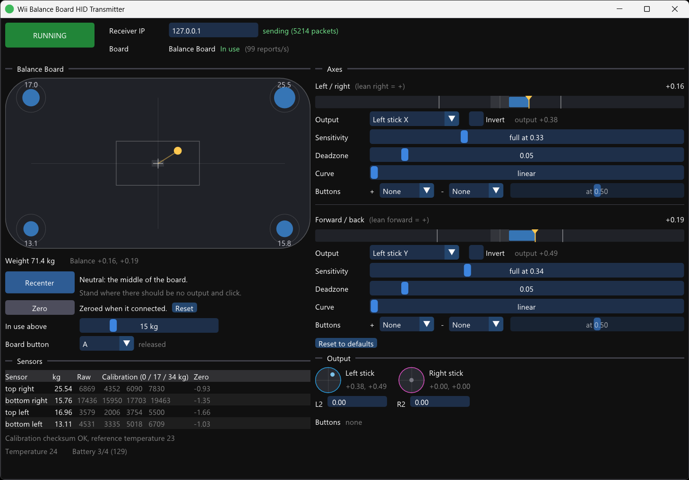

# Wii Balance Board HID Transmitter

This is a Windows application that lets you use the [Wii Balance Board](https://en.wikipedia.org/wiki/Wii_Balance_Board) as a gamepad. Leaning left / right and forward / back can each drive an analog stick axis or the analog triggers, and press buttons when you lean past a threshold. The board's own button can work as a gamepad button too.

It acts as the Transmitter component of a [HID Forwarder](https://github.com/jfedor2/hid-forwarder) setup. The gamepad inputs generated are sent to the configured Receiver. This way you can control a game on the same PC or on a separate computer or console.

You will probably want to use one of the tools from the [HID Router](https://github.com/jfedor2/hid-router) project to combine the inputs generated with the 3dRudder with inputs from other sources like actual game controllers, and to create a virtual controller on your PC (if that's your goal).

For downloads see the [latest release](https://github.com/jfedor2/wii-balance-board-hid-transmitter/releases/latest).

See also: [Face HID Transmitter](https://github.com/jfedor2/face-hid-transmitter), [Voice HID Transmitter](https://github.com/jfedor2/voice-hid-transmitter), [Overlay HID Transmitter](https://github.com/jfedor2/overlay-hid-transmitter), [3dRudder HID Transmitter](https://github.com/jfedor2/3drudder-hid-transmitter).

## Pairing

Please note that can't pair the Wii Balance Board with your PC using the default Windows 11 user interface because it won't let you use a blank PIN. You have to use the `devicepairingwizard` utility (run it using the Windows-R "Run" dialog box).

## Usage

Once you have the board paired with your PC, you can run the application. It finds the board by itself and reconnects if it goes away. The board's LED is on while the app is using it.

- **RUNNING / STOPPED** turns sending on and off.
- The window icon shows the state. The left half is the board: yellow when it's connected but nobody is on it, green when it's in use. The right half is red when sending is stopped, green when running. The whole circle is red when no board is found.
- **Receiver IP**: the IP of the receiver. Inputs go to UDP port 42734.
- The **board view** is the board from above. The circles in the corners are the four weight sensors, with the kg on each. The yellow dot is your balance (the center of pressure), the cross is neutral, the shaded box around it is the deadzone and the outlined box is where the output is full.
- **Weight** is the total on the board. **Balance** is where it is: -1..1 left / right and forward / back, where 1 means all the weight is on the right (or front) sensors. This doesn't depend on how heavy you are.
- **Recenter** takes your current balance as neutral, for when you don't stand exactly in the middle. It's saved. **Reset** goes back to the middle of the board.
- **Zero** takes what the board reads when empty as zero. The factory calibration can be off by a few kg (on the board this was written with, every sensor read 1-1.7 kg below zero). It's done automatically when the board connects if it's roughly empty then (within 10 kg). It isn't saved, because the empty readings change with temperature.
- **In use above**: with less weight than this on the board, the balance gives no output. Set it lower if you want to use it while sitting in a chair with your feet on the board, not standing on it.
- **Board button**: what the button on the front of the board presses. It works whether or not anyone is on the board.
- **Sensors** shows each sensor's weight, raw reading and calibration, plus the board's temperature and battery.
- Under **Axes**, each axis has a bar with the current value (yellow marker), the deadzone (shaded), the points of full output (white lines), the button thresholds (orange ticks) and the output (blue).
  - **Output**: the stick axis or triggers this axis drives. For sticks, the + side (lean right, lean forward) moves the stick right / up. "L2 / R2" puts the + side on R2 and the - side on L2. Several axes can drive the same output, and they add up.
  - **Invert** swaps the + and - sides.
  - **Sensitivity**: how far from neutral (on the -1..1 balance scale) for full output. Lower = more sensitive.
  - **Deadzone**: how far from neutral with no output.
  - **Curve**: 1 is linear. Higher values give finer control near neutral and still reach full output at the same point.
  - **Buttons**: a button for each side, pressed when the axis goes past the threshold, which runs from 0 (just outside the deadzone) to 1 (full). The buttons work with or without an analog output.
- **Reset to defaults** puts the axis settings, the board button and the minimum weight back. By default, left / right drives the left stick X, forward / back drives the left stick Y and the board button is A.
- **Output** shows the sticks, triggers and buttons being sent.

Settings are saved automatically to `%APPDATA%\wii-balance-board-hid-transmitter\wii-balance-board-hid-transmitter\settings.json`.

Pass `--start` on the command line to start in the running state.

## License and acknowledgements

The software in this repository is licensed under the [MIT License](LICENSE).

The UI uses [Dear ImGui](https://github.com/ocornut/imgui) (MIT) and configuration uses [nlohmann/json](https://github.com/nlohmann/json) (MIT).
